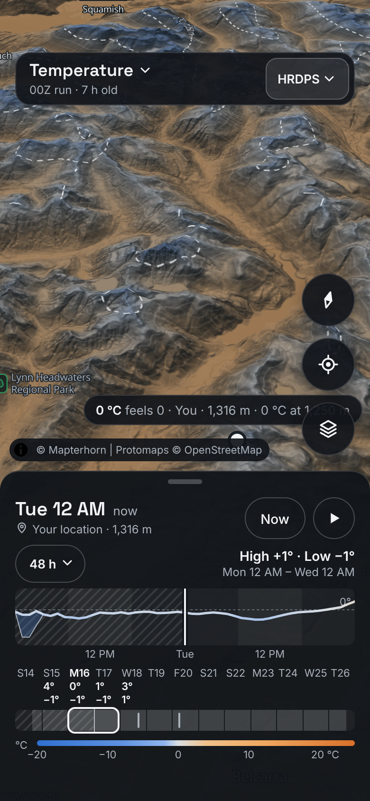
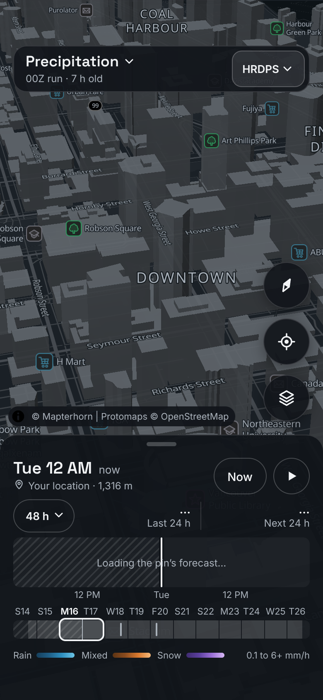

# 3D map report: terrain and buildings

Nov 17, 2026. The study behind this is in `docs/spikes/3d-terrain.md`.

## What you can try on the phone

1. **Open the map panel** (the layers button). TERRAIN now has two more switches: **3D terrain** and **3D buildings**. Both are off until you turn them on, and are remembered.
2. **Turn on 3D terrain.**
   - The map tilts to look across the mountains.
   - Two fingers tilt it and turn it.
   - The weather colours lie on the slopes, and so do the hillshade, contours, the freezing and snow lines, and saved-area outlines.
3. **The compass button** appears above the locate button whenever the map is tilted or turned. Tap it to go back to flat and north up.
4. **Turn on 3D buildings** and zoom into a town. Buildings stand up at their mapped heights from zoom 14, in neutral greys that follow the light or dark theme.

## How it works

- **Terrain heights** come from the same Mapterhorn terrain the hillshade already uses. They are shown at true height, with no exaggeration.
- **The weather colours are laid onto the terrain by the map engine itself,** a tile at a time, using the same drawing code and colour strips as the flat map. So nothing about the data changes in 3D. This uses a new, still-experimental part of MapLibre, the map engine. If it misbehaves, the fallback is to hide the colours while tilted; only the drawing code would change.
- **Changing the hour in 3D swaps the colours at once,** instead of the short cross-fade on the flat map, because fading would redraw every terrain tile on every frame.
- **Wind particles pause while the map is tilted or turned.** They are drawn flat on the screen and would not line up with the slopes. The wind colours still show.
- **Building heights** come from OpenStreetMap through the base map files. Footprints with no recorded height are drawn about two storeys tall (6 m). That is a stated default, not data.

## What to know

- **Speed on a phone is not measured yet.** The test machine draws with software instead of a graphics chip. There, one terrain tile cost about as much as one flat-screen fill, and still frames cost nothing extra. **Please try tilting and scrubbing time in 3D on your phone,** with the temperature or wind layer on, and tell me if it stutters or gets warm.
- **Buildings are sparse outside the detail areas.** Downtown Vancouver had 133 of 139 buildings with heights at zoom 14. The North Shore piece has many footprints but few heights. Full Metro Vancouver coverage would need finer base map pieces: about 35 MB more (1.8 MB for downtown alone).
- **When tilted steeply,** the area the weather covers grows toward the horizon, and the terrain behind it is read at coarser detail.
- **The pin's readout can sit under the round buttons** when tilting pushes the pin low on the screen.
- **Not designed in v8:** the compass button is the existing round button with a compass icon.

## Checks

- Unit tests pass, including the new terrain-drape maths.
- The 3D browser tests pass: switching each switch on and off, the tilt, and the compass. The flat-map pictures are unchanged with 3D off.
- The map panel picture is re-baselined for the gear and the two new switches.
