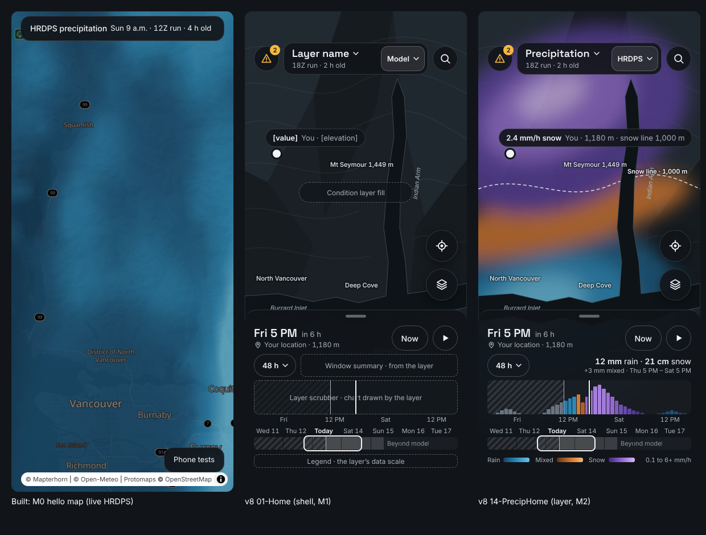

# M0 report: setup and spikes

Nov 15, 2026.

## What works now

Once the preview site is set up (see "What I need from you"), you can try two pages on your phone:

- **Hello map.** Opens on the North Shore and Sea to Sky with a dark base map, hillshade, contour lines and this hour's HRDPS precipitation from the latest run. The bar at the top says which hour you're looking at and how old the model run is. You can pan and zoom. It is not the Tempest shell yet; that's M1.
- **Phone tests** (button at the bottom of the hello map). One button runs every phone test: drawing speed, frame rate while panning, storage, and saving a 48-hour weather file and a map file to the phone. Then "Copy results" puts everything on the clipboard for you to paste to me.

Behind the scenes:

- The project is set up with automatic checks (types, lint, 20 unit tests, build and 3 browser screenshot tests at 390 × 844). They run on every push on GitHub.
- The lint checks enforce the architecture rules: core logic can't touch the screen, only one folder may use the GPL weather library, and layers can't use each other.
- A small tool measures and cuts map files for any area. That's how the sizes below were measured.

## Screenshots

Differences, all expected at M0:

- No shell yet: no top bar, sheet, pin, thumb buttons or scrubber. Those are M1.
- The base map uses the Protomaps dark style with our map-ground and water colours. The Tempest topo style comes in M1.
- Precipitation uses the rain colours only. Rain, mixed and snow come in M2.
- Light rain covers the whole region this morning, so the whole map is tinted blue. In v8 the dark ground shows through where it's dry. That's correct for the data, but **the lowest rain colour may read too strongly over large areas.** Worth watching on the phone in M2.

## Decisions I made

- **Hosting: Cloudflare, free plan,** connected to GitHub. GitHub Pages is out: your repo is private, and Pages can't send the security headers the weather library wants. Steps in `docs/hosting.md`.
- **Our own map files.** The Protomaps daily build can't be read by other websites, so the build cuts our own region file from it (Sea to Sky, 20 MB). It isn't stored in the repository.
- **Terrain up to zoom 12 only.** Finer terrain costs about 40 times more space for little visible gain on BC's 30 m data (spike 3).
- **A fallback for hosts that won't send part of a file.** If the host sends the whole map file, the app keeps it and works anyway.
- **TypeScript 6.0, not 7.0.** The lint tools don't support 7 yet.
- **Created a "tempest" cloud environment** with only the map and weather servers allowed, instead of opening the network fully.
- Updated the domain list in `README.md` to the current servers.

## Facts checked

Full list: `docs/spikes/00-facts-checked.md`. Highlights:

- **HRDPS is in Open-Meteo's map files.** So is a **1 km "HRDPS West" covering all of BC** (twice a day), plus RDPS, GDPS and the GEPS ensemble.
- **Open-Meteo's map data moved** to an Amazon address. The one in our docs is gone.
- The HRDPS files include temperatures and heights on 30 pressure levels, which is exactly what the terrain-temperature method needs (M4). They **don't include freezing level or snow line.**
- **Mapterhorn terrain now includes Canada's 2 m lidar** in parts of BC, Sea to Sky included.
- **The weather library's file decoder is also GPL-2.0.** So replacing the drawing library in M3 doesn't by itself remove GPL code. See the decision below.
- **Avalanche Canada moved its API** to new addresses. Its only written terms are the website's: no copying without written consent.
- MapLibre 6 changed how it's loaded; handled.

## Download sizes (spike 3)

| Area | Base map (zoom 14) | Terrain (zoom 12) | 48 h of one weather variable |
| --- | --- | --- | --- |
| Sea to Sky | 19.9 MB | 30.7 MB | 0.3 MB |
| Kootenay Pass to Whitewater | 4.6 MB | 21.2 MB | (similar) |

All of BC's base map to zoom 13 would be about 665 MB.

## Spikes

| # | Spike | Result |
| --- | --- | --- |
| 1 | Open-Meteo map files | Yes, HRDPS is there; partial reads work |
| 2 | Phone performance | **Needs your phone** |
| 3 | Download sizes | Done (above) |
| 4 | Avalanche Canada | Terms read; email drafted for you |
| 5 | Trail coverage | Partly: 3,820 named paths in the Sea to Sky base map; difficulty tags need a separate extract. The query server refuses this cloud machine |
| 6 | Probability | Deferred, as planned |
| 7 | Security headers | Work on desktop; the weather still draws without them. **Phone pending** |
| 8 | Region file end to end | Works: 48 h of Sea to Sky rain in 292 kB, cut in 7 s, saved and read back. **Phone pending** |
| 9 | Map file in phone storage | Works on desktop: 200 tile reads in about 0.25 s. **Phone pending** |

Each has a write-up in `docs/spikes/`.

## Plan changes I propose

1. **M1 needs big-file storage for the base map beyond the Sea to Sky.** Normal hosting caps files at 25 MB. I propose Cloudflare R2 (free up to 10 GB) on the same account, with a BC base map cut into pieces. Until then the map covers the Sea to Sky only.
2. **M2: where freezing level and snow line come from.** They aren't in the map files. Options: Open-Meteo's point forecast for the pin (simple, but no map line), or work them out from the pressure-level temperatures in the map files (gives a map line, and reuses M4's method). I lean to the second, and would bring part of M4's terrain work forward.
3. **Consider HRDPS West (1 km) as the main high-resolution model** once M6 adds model choice. It is the finest BC detail available, but it updates only twice a day.
4. **Pixel-perfect screenshot tests start in M1,** with weather answered from saved test files. M0's live data changes every hour, so its tests check structure instead.

## What I need from you

1. **Set up hosting** (about 10 minutes): make a free Cloudflare account and connect the Tempest repository. Steps in `docs/hosting.md`. Send me the site address.
2. **Run the phone tests** twice once the site is up: once in Safari, once after Share → Add to Home Screen. Tap Copy results each time and paste them to me.
3. **Send the Avalanche Canada email** when it suits you. The draft is in `docs/spikes/04-avalanche-canada.md`.
4. **Confirm the defaults** taken for you (decisions, section 2): start region North Shore and Sea to Sky; iPhone home-screen web app first; metric; free sources only; no routes in the first build; dark two-peak icon; temperature day/night averages in the TODAY card; layer menu shows only built layers; top bar 8 px below the status bar; the recommended stack; the GPL library behind one seam.
5. **A decision on the GPL question, when convenient.** The library and its file decoder are both GPL-2.0. Keeping the repository private is fine while only you use the app. If you share it with friends, the simple answer is to make the repository public.
