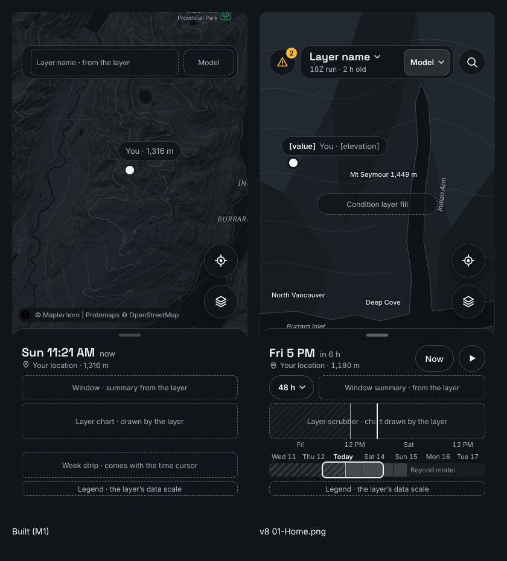
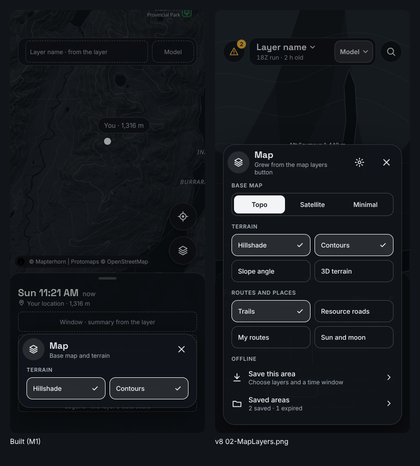
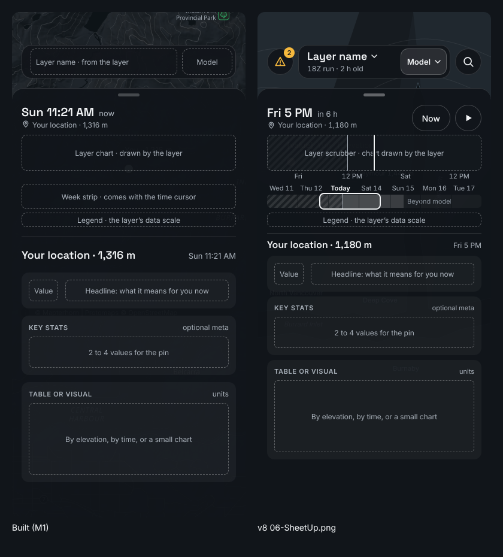

# M1 report: map and shell

Nov 15, 2026.

## What you can try on the phone

Open https://1kadenfoy-bit.github.io/Tempest/. Remove the old home-screen icon and add it again, so you get the new installable version.

- **The map opens on you.** It asks for your location once. The pin sits on you, labelled "You" with your elevation from the terrain data. If you say no, or there's no fix, the pin goes to the last place you used, labelled "Last pin".
- **Tap anywhere** to move the pin. The readout and the place line show the nearest named place (a peak first) and its elevation. **Locate-me** brings the pin back to you.
- **The map covers all of BC.** Zoom in close on the North Shore, the Sea to Sky or the Kootenay Pass to Whitewater area to see trails. Elsewhere the map stops adding detail at a medium-close zoom and just enlarges, so trails don't show there.
- **Map layers button:** the map panel grows out of it, and the map dims behind it. Hillshade and Contours switch on and off, and the app remembers your choice. Close it with × or by tapping the dimmed map.
- **The bottom sheet:** tap or drag the handle to pull it up under the top bar, and drag it down again. Tap the place line ("Your location · 1,316 m") to centre the map on the pin.
- **Installable:** Share → Add to Home Screen gives the Tempest icon and a full-screen app, with the map running up behind the status bar as in v8. The app's own files are kept on the phone, so it should open faster than the 3.4 s you measured.

## Screenshots

Differences from v8, all on purpose:

- **Alert badge and search are missing.** Rule: a button appears only when it works. Alerts and search come in M9.
- **Layer name and Model are dashed slots,** like the sheet's slots: the first layer fills them in M2.
- **No Now, Play, window control or week strip yet.** They come with the time cursor in M2. Their places are dashed slots, and the time row shows the current time.
- **The map panel shows only Terrain → Hillshade and Contours.** Base map (Topo, Satellite, Minimal), Slope angle, 3D terrain, Routes and places, Offline, and the settings gear appear when they work.
- **Map labels use Noto Sans, not Inter.** The map draws text from special font files, which exist for Noto Sans but not Inter. All interface text is Inter and Space Grotesk, self-hosted from the v8 files.
- **The map is real** rather than the drawn sample. The North Shore labels (North Vancouver, Deep Cove) show when you zoom out a little from Mt Seymour.
- **Pulled up:** the details area shows the standard card placeholders from 06-SheetUp. The Value, Headline and card contents are layer slots for M2 and M5.

## Decisions I made

- **Base map for all of BC in 28 pieces (about 680 MB).** GitHub limits single files to 100 MB and the whole site to 1 GB. The app treats the pieces as one map.
- **Trails show only at the closest zoom, and only in "detail regions".** Protomaps adds paths at zoom 14, and zoom 14 for all of BC would be about 1.4 GB. So zoom 14 is stored for the Sea to Sky and the Kootenay Pass box (12 MB together). Elsewhere the map enlarges zoom 13, without trails. **Tell me which areas you tour and hike, and I'll add them;** each costs 2 to 10 MB. The list is in `tools/regions.json`.
- **Map colours come from the tokens.** The map ground and water tokens, with the ink colour mixed in faintly for roads, land cover and labels. Map labels use the ink and ink-2 tokens with a water-coloured halo.
- **The pulled-up sheet covers the map** without moving it. The map's centre stays on the part above the collapsed sheet.
- **Place names for a dropped pin** come from the nearest label on the map, preferring peaks. If there's no label nearby, it says "Dropped pin".
- **Elevation** comes from the same terrain data as the hillshade, at about 12 m detail.
- **Rotation and tilt are off.** One-finger and two-finger gestures only pan and zoom, which is easier with gloves.
- **Map panel caption:** "Base map and terrain". The v8 caption ("Grew from the map layers button") describes the design, not the app.

## Facts checked

- **BC's clocks:** the time-zone data in this year's software (tz 2026e) has BC staying on UTC−7 after November 1, 2026, which suggests permanent daylight time. The app shows times from your phone's own time-zone data, so it follows whatever iOS knows.
- **Trails in the base map start at zoom 14:** the Mt Seymour tile has 1 road or trail feature at zoom 13 and 22 at zoom 14 (spike 3 follow-up).
- **MapLibre 6** needs its worker loaded separately (handled since M0). Its protocol hook is what lets the 28 map pieces act as one map.
- **iOS home-screen apps:** the translucent status-bar setting puts the map under the status bar, and the app now uses the real safe areas for the top bar and sheet.

## Checks

- **Unit tests:** 32 pass. They cover the map-piece lookup, enlarging zoom 13 into zoom 14, terrain elevation, time and elevation formatting, the region file, and run age.
- **Browser tests:** 11 pass at 390 × 844.
  - Top bar at 16/55/358 × 56, sheet collapsed at 320 px, thumb buttons 16 px above the sheet.
  - Pin readout, tap to move, locate-me, and the fallback to the last pin.
  - Map panel open, switch, close by scrim, remembered after reload.
  - Sheet up at 127 px and dragged back down.
  - The enlarged zoom-14 map at Hope.
  - Installable: Chrome reports no installability errors.
  - Pixel comparisons of the shell (with the map hidden) against saved baselines.

## What I need from you

1. **Merge pull request #2 (M0).** #1 closed itself when I rewrote `main` to hide your email. #2 has the same content. The M1 pull request follows once M0 is in.
2. **Try M1 on the phone** and tell me what feels off: sheet drag, panel growth, readout and elevation, map look.
3. **Which areas you go to,** for trail detail. For example Whistler backcountry, Duffey Lake, Rogers Pass, the Coquihalla.
