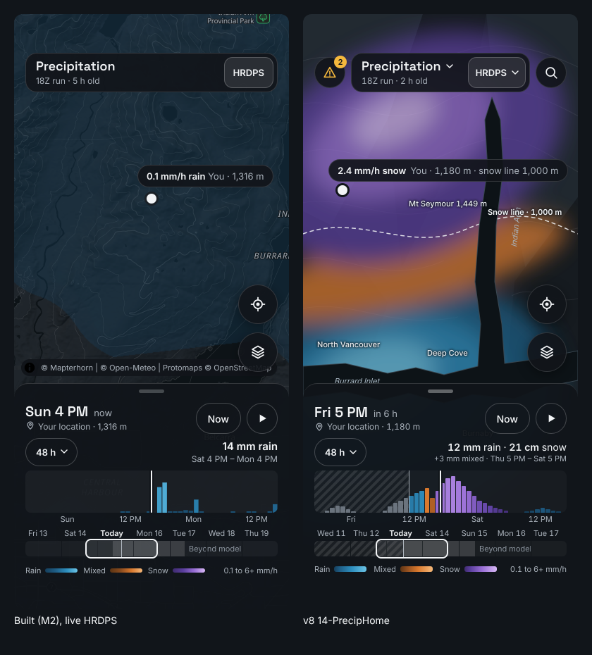
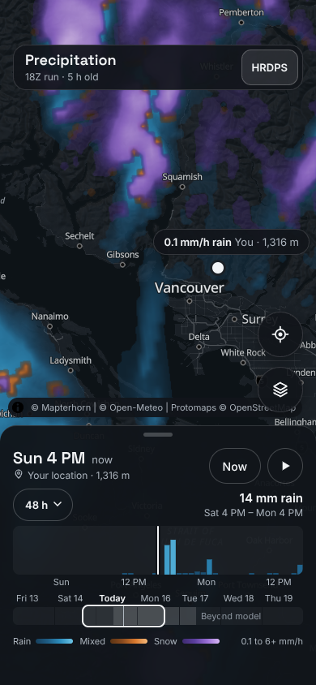

# M2 report: precipitation on the map

Nov 16, 2026.

## What you can try on the phone

Open https://1kadenfoy-bit.github.io/Tempest/ from the home-screen icon.

- **The map shows precipitation from the latest HRDPS run:** rain in blue, mixed in orange, snow in purple. Light drizzle is see-through so the terrain stays readable; heavier precipitation is solid and lighter in colour.
- **The top bar** reads "Precipitation", the run and its age ("18Z run · 5 h old"), and "HRDPS". The age turns amber if the run is 12 hours old or more.
- **The pin's readout** gives the rate and type at the pin, then "You · elevation": "0.1 mm/h rain You · 1,316 m", or "Dry".
- **Drag the chart** left or right to move through time. The bars slide under the fixed needle, and the map, readout and time all follow: one cursor for the whole app. You can also drag or tap the week strip.
- **Now** jumps back to the current hour. **Play** steps through the hours and stops at the end of the model.
- **The window button** ("48 h") opens 12 h, 24 h, 48 h, 3 d and 7 d. It sets the chart's span and the white box on the week strip together, and the app remembers it.
- **The window summary** gives totals by type over exactly the window (for example "14 mm rain", with snow in cm and mixed in mm when there is any), with its date range underneath.
- **The week strip** shows two days back to four ahead, the model's reach, and "Beyond model" after its last hour.

## The acceptance test: the pin matches Open-Meteo

GitHub's test machine read 48 hours at the pin from the same files the map draws. It compared them with Open-Meteo's own point forecast for HRDPS, same run (18Z, Nov 15):

| Place | Hours compared | Within 0.1 mm | Largest difference | 48 h total, app vs Open-Meteo |
| --- | --- | --- | --- | --- |
| Mt Seymour | 48 | 48 | 0.00 mm | 16.9 vs 16.9 mm |
| Whistler | 48 | 48 | 0.00 mm | 11.2 vs 11.2 mm |
| Vancouver | 48 | 48 | 0.00 mm | 2.8 vs 2.8 mm |

This runs on every push. The phone test page has the same check ("point check" lines).

## Screenshots

Differences from v8:

- **No snow line** on the map or in the readout. HRDPS's map files don't include freezing level or snow line (M0 spike 1). The planned fix is to work them out from the pressure-level temperatures, which is the M4 temperature method. The map line and its setting arrive with that.
- **No grey "observed" hours** at the left of the chart and week strip. Observed data comes in M6, so the past part of the week is empty for now.
- **Alert badge, search, layer menu and model menu are still missing.** They arrive in M9 (alerts, search) and M6 (models). The layer name and HRDPS have no chevrons until they open something.
- **The map steps hour by hour** rather than blending between hours while you drag. Smooth blending comes with the app's own renderer (M3).

## Decisions I made

- **Rain, mixed or snow** comes from the model's own split: the share of each hour's precipitation that fell as snow. Under 20% is rain, over 80% is snow, between is mixed. The map, chart, readout and totals all use the same rule.
- **Snow depth in the totals** uses Open-Meteo's fixed conversion (10 mm of water = 7 cm of snow). The snow-ratio setting (model's own, Kuchera, 10:1) comes with the layer settings in M5.
- **Each hour's value is the amount that fell in the hour ending at that time.** So "Fri 5 PM" means 4 to 5 PM, as Open-Meteo labels it.
- **Light precipitation is see-through:** 40% opacity at 0.1 mm/h, full from 2 mm/h. Colours still come from the token ramps.
- **The window is centred on the cursor.** The needle stays in the middle, as in v8. Moving the cursor near the model's start leaves the left half of the chart empty.
- **The pin's numbers come from the same map files the map draws,** not from a separate service, so map and tap always agree. They're kept in memory for the session. Saving to the phone comes in M3.
- **Drizzle under 0.1 mm/h reads "Dry"**, and the map draws nothing below 0.1 mm/h, the fixed cutoff.

## Facts checked

- **Open-Meteo's point forecast** matches the map files exactly for HRDPS, at the nearest grid cell (table above).
- **Open-Meteo's daily limit** blocked this cloud machine all day, so the comparison runs on GitHub's machine and on your phone instead.
- **The starter library** accepts the app's own computed variables (rain, mixed, snow from precipitation and snow water equivalent). That's how the map colours by type without baking colour into the data.

## Checks

- **Unit tests:** 47 pass. New since M1: the time cursor, the window and week strip maths, totals by type, the rain/mixed/snow rule, amount formatting, the store, and the comparison with Open-Meteo.
- **Browser tests:** 17 pass at 390 × 844. New since M1:
  - Top bar, readout, summary and fills.
  - Dragging the chart moves time; Now and Play.
  - The window control resizes the week box and is remembered.
  - The readout stays inside the screen.
  - The Open-Meteo match.

## What I need from you

1. **Try it on the phone:** the drag feel of the chart, the colours, and whether the readout and totals make sense for where you are.
2. **The screen-edge bands:** run the phone test page from the home-screen icon once and send me the "layout:" line, so I can confirm the fix for the bands.
3. **Pull request #2** now holds M0, M1 and M2. GitHub only lets me push to one branch, and #2 wasn't merged yet. Merge it when you're happy, and M3 will start a fresh pull request.
4. **Say go for M3** (offline proof: save the area, then airplane mode).
