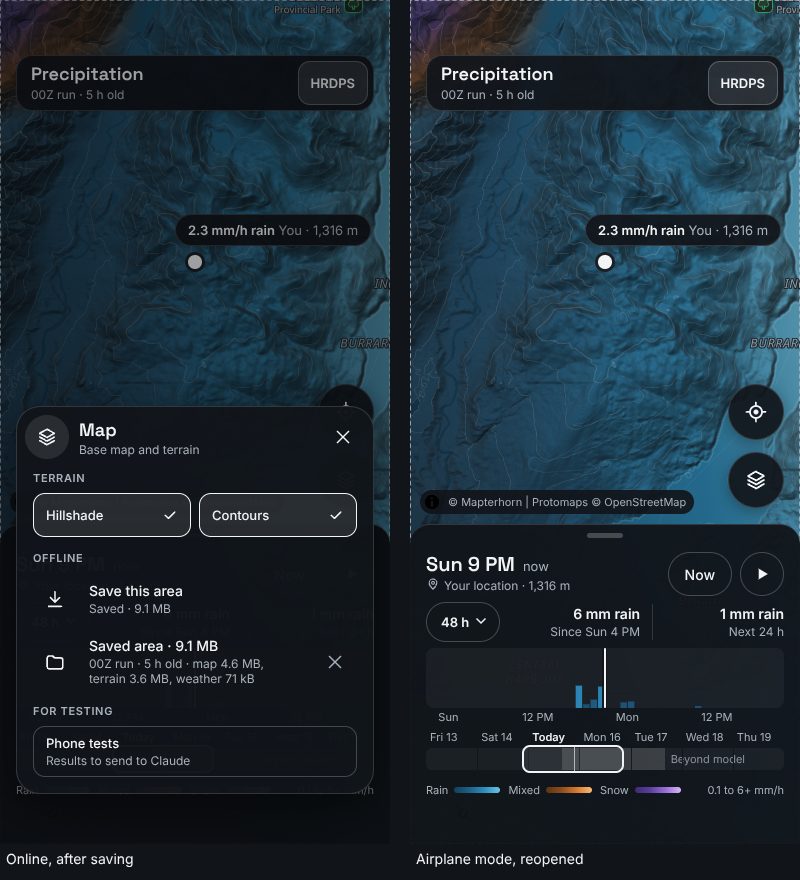
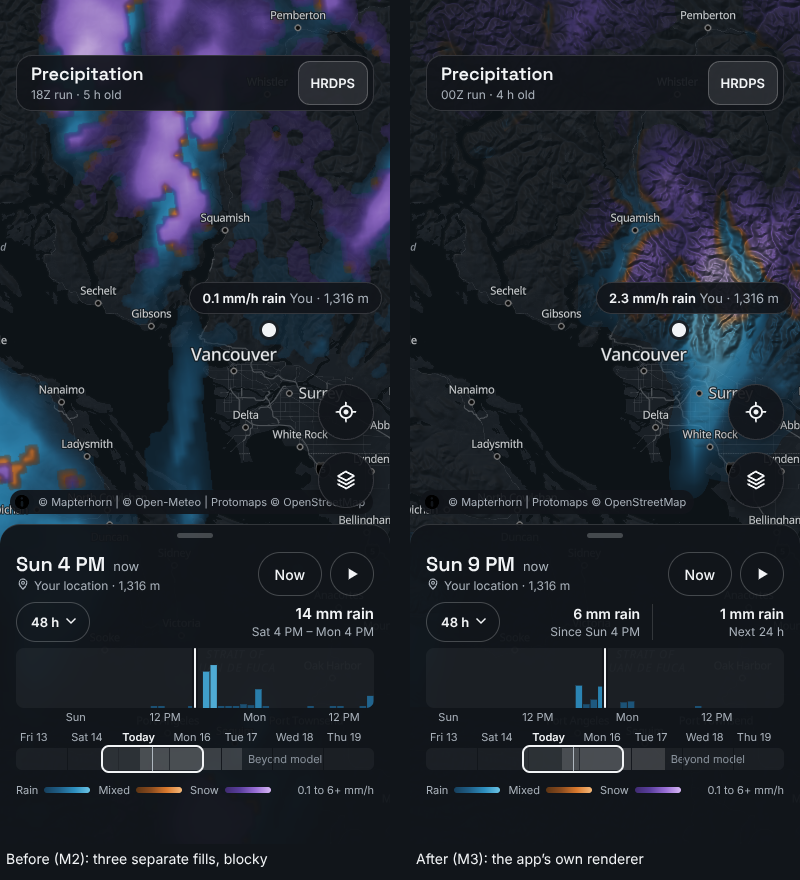
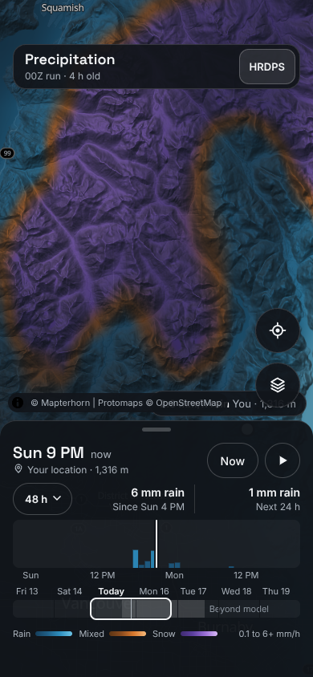

# M3 report: offline proof

Nov 16, 2026.

## What you can try on the phone

Open Tempest from the home-screen icon (close it fully first, so it picks up the update).

1. **The new precipitation picture:** rain, mixed and snow now blend smoothly, following the terrain, with no blocks and no overlapping colours. The hillshade and contours show through.
2. **Save an area:** pan and zoom so the area you want fills the screen. Open the map panel and tap **Save this area**. It shows progress, then "Saved · N MB". The saved area appears below it with its model run, its age and its sizes, and a dashed outline marks it on the map.
3. **Airplane mode:** switch it on, close Tempest fully, and open it again. Inside the dashed box you should see the same map, terrain and precipitation. The pin's readout, the totals, dragging the chart and Play should all work.
4. **Remove it:** the × on the saved area's row.

## The acceptance test

"Saving on Wi-Fi then switching to airplane mode shows the same picture and numbers for the saved area."

On every push, GitHub's test machine saves an area, goes offline, reopens the app and compares:

| | Online | Airplane mode |
| --- | --- | --- |
| Run | 00Z run · 5 h old | 00Z run · 5 h old |
| Pin readout | 2.3 mm/h rain · You · 1,316 m | 2.3 mm/h rain · You · 1,316 m |
| Since Sun 4 PM | 6 mm rain | 6 mm rain |
| Next 24 h | 1 mm rain | 1 mm rain |

Identical. Play also moves through the saved hours offline.

## Real download sizes

| Area saved | Base map | Terrain | Precipitation (48 h) | Total | Time on a fast connection |
| --- | --- | --- | --- | --- | --- |
| Screen at zoom 11 around Mt Seymour (about 15 × 25 km) | 4.6 MB | 3.6 MB | 71 kB | 9.1 MB | 5 s |
| One-degree square, Vancouver to past Squamish (about 70 × 110 km) | 24.3 MB | 23.6 MB | 0.65 MB | 49.5 MB | 20 s |

Precipitation is tiny next to the map and terrain, as the M0 spikes predicted. Map fonts and icons add about 0.8 to 0.9 MB (the rest of each total).

## The new renderer

(The two pictures are from different model runs, so the weather itself differs.)

- **The drawing is now the app's own.** The starter library only reads Open-Meteo's files.
- **Each pixel is coloured from two numbers:** the precipitation rate, and how much of it is snow. Rain, mixed and snow blend by that share, using the token colour strips. Snow edges come out smooth, and the mixed band follows the mountains.
- **Changing the hour fades the picture over a fifth of a second.** Readouts still use the real model hours.
- **The renderer draws plain latitude/longitude grids.** The adapter converts the model's rotated grid for the area in view, at the model's own 2.5 km spacing close in and coarser when zoomed out. The next hour is fetched ahead.

## Decisions I made

- **Saving keeps the model's own grid cells, not a resampled copy.** That's what makes the offline numbers exactly the online ones. Online, the pin reads the nearest model cell, as Open-Meteo does; offline it reads the same cell from the saved copy.
- **The minimal save** takes the area in view, up to about one degree square around its centre. Dragging a box, choosing layers and choosing a window are the full save flow in M8.
- **One saved area at a time** for now; saving again replaces it. The saved areas list (several, with refresh) is M8.
- **Where saved data lives:**
  - Weather and the base map file go in the phone's private file system for the app.
  - Terrain tiles, map fonts and icons go in the app's offline cache, which the service worker serves without signal.
  - iOS keeps both for good for the home-screen app (M0 spike 9).
- **The service worker now keeps every file of the app when it installs,** using a list the build writes. The app opens without signal from the next launch, even after a first visit.
- **The saved base map** includes every map level stored for the box. In the North Shore and Sea to Sky detail areas that includes the trail levels (zoom 14 and 15).

## Facts checked

- **MapLibre 6's custom layers** project with `defaultProjectionData.mainMatrix` for 0–1 Web Mercator coordinates. The older matrix it also offers works in different units and drew nothing.
- **Precision on the phone:** WebGL 2 float textures are used without float filtering, which iPhones may not offer; the blending between cells is done in the shader.
- **The app's PMTiles writer** produces files the standard PMTiles reader reads back, tested with a big archive that needs a two-level index.
- **The app's files are served with "Vary: Origin",** which stopped the service worker matching kept copies. It now matches by address.

## Checks

- **Unit tests:** 58 pass. New: the PMTiles writer round trip, the saved-area record, the grid request rule.
- **Browser tests:** 19 pass at 390 × 844. New: the offline acceptance test above. The fill test now checks the new renderer.

## What I need from you

1. **Try it on your phone:** save an area at home, then use it in airplane mode. Tell me what you see, and how long the save took on your connection.
2. **The new precipitation look:** does it read better?
3. **Pull request #2** holds M0 to M3 together. Merging it lets the next milestone start a fresh pull request.
4. **Say go for M4** (temperature at terrain height, and the layer menu).
