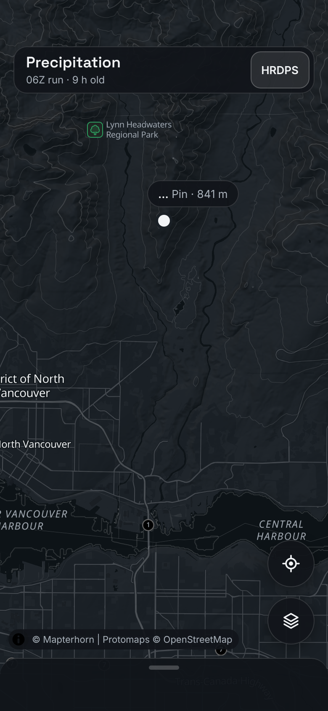
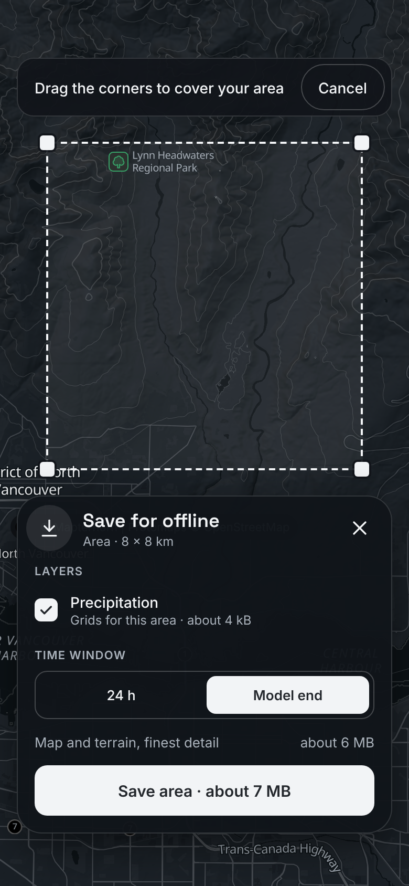
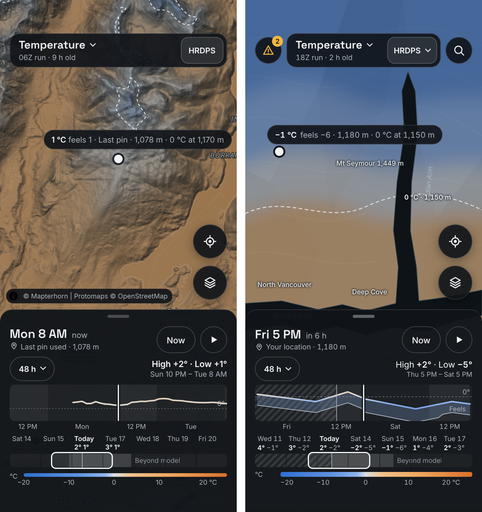
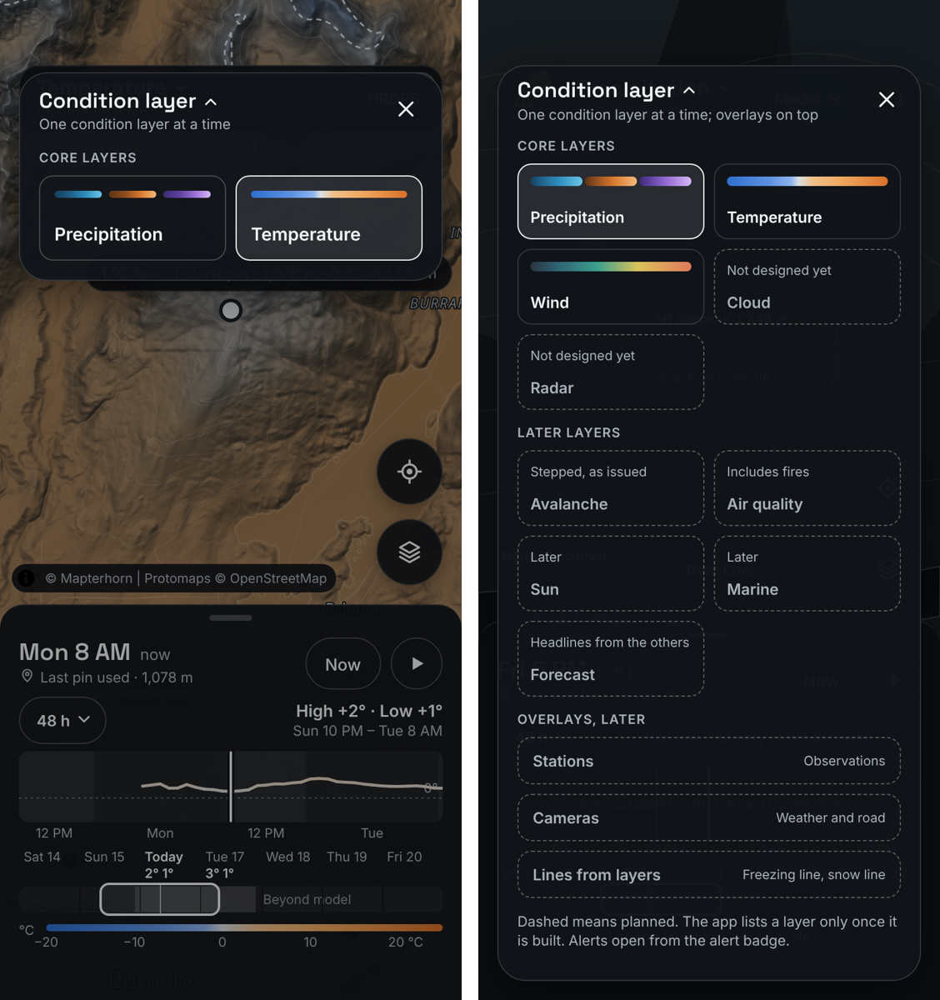

# M4 report: temperature

Nov 16, 2026.

## First, the three fixes from your M3 test

1. **The info sheet no longer drops out of sight.** When you slide it down, it now stops with its handle on screen. I measure against the height the phone really shows; the installed iPhone app reports a taller screen than it shows, which pushed the sheet off the bottom.
2. **Saving an area uses an adjustable box** (design 08-SaveArea). Tap **Save this area** in the map panel. A dashed box with four corner handles appears over the map. Drag the corners, or move the map under the box. The panel below shows the area in km, the layers to save, the time window (24 h or to the model's end), and the size before you tap **Save area**.
3. **Mixed rain and snow totals stack**, one per line, so each one reads in full.

| Tucked sheet | Save box, beside 08-SaveArea |
| --- | --- |
|  |  |

## What you can try on the phone

Close Tempest fully and reopen it, so it picks up the update.

1. **Tap the layer name** ("Precipitation ⌄") at the top. The layer menu grows from it with the two built layers. Tap **Temperature**.
2. **The map** turns into temperature at the ground: warm colours in the valleys, blue on the peaks, neutral grey at 0 °C. Dashed lines mark where the slopes cross 0 °C, labelled with the height ("0 °C · 1,190 m").
3. **The pin** reads, for example, "1 °C feels 1 · You · 1,078 m · 0 °C at 1,170 m". That's the temperature at your ground height, feels-like (Canadian wind chill or humidex), and the freezing level.
4. **The sheet:**
   - The chart: a thick line coloured by temperature, a thin feels-like line, the gap between them shaded blue (feels colder) or warm (feels warmer), a 0° guide, and lighter bands for daylight.
   - The summary: "High +2° · Low +1°" over the window.
   - The week strip: each day's high and low under its name.
   - The legend: −20 to +25 °C.
5. **Drag the chart or press Play.** The map and the 0 °C line follow the hour.
6. **Save an area with both layers ticked.** Temperature then works in airplane mode too.
7. The app remembers the layer you chose.

Differences from the designs:

- **Layer menu:** shows only Precipitation and Temperature. Wind and the other planned layers appear once they work, as the design note says. The caption is shortened to "One condition layer at a time", since there are no overlays yet.
- **Top bar:** no alert badge, search button or model menu yet. Those come in later milestones.
- **Daily high and low:** shown only for days the model covers for at least 12 hours. HRDPS reaches 48 h, so that's today and tomorrow. The design's past days need observed data, which comes in M6.

## The acceptance test

"A ridge and the valley below it read differently, and a spot check against the Windy plugin or a station is within a degree or two."

**Ridge and valley** (06Z run, 7 AM Monday):

| Place | Height | Tempest | The model's own 2 m value |
| --- | --- | --- | --- |
| Mt Seymour summit | 1,449 m | −1.5 °C | +3.3 °C |
| Lynn valley floor | 220 m | +7.7 °C | +2.0 °C |
| Deep Cove | 5 m | +9.0 °C | +7.8 °C |

The model's ground is smoothed over 2.5 km squares, so its own value puts the summit above freezing. Corrected to the real ground, the summit is below freezing and the valley floor is 9° warmer.

**Stations** (14 ECCC stations from Vancouver to the Callaghan, 7 AM Monday, the same hour of the same run):

| Station | Height | Measured | Tempest | Model's own 2 m |
| --- | --- | --- | --- | --- |
| Callaghan Valley | 887 m | 1.7 | 1.5 (−0.2) | −0.9 (−2.6) |
| Whistler – Nesters | 662 m | 2.4 | 3.1 (+0.7) | 0.3 (−2.1) |
| Whistler | 658 m | 2.3 | 2.0 (−0.3) | −0.4 (−2.7) |
| West Vancouver | 171 m | 8.5 | 7.8 (−0.7) | 5.2 (−3.3) |
| Port Mellon | 131 m | 7.6 | 8.4 (+0.8) | 6.3 (−1.3) |
| Squamish Airport | 57 m | 5.8 | 7.5 (+1.7) | 4.8 (−1.0) |
| Point Atkinson | 15 m | 10.1 | 9.5 (−0.6) | 9.5 (−0.6) |
| Pam Rocks, Howe Sound | 9 m | 8.2 | 10.2 (+2.0) | 10.3 (+2.1) |
| Vancouver Harbour CS | 4 m | 8.9 | 8.6 (−0.3) | 7.3 (−1.6) |
| Vancouver International | 4 m | 7.2 | 8.2 (+1.0) | 8.1 (+0.9) |
| Sea Island | 4 m | 7.3 | 7.3 (0.0) | 6.7 (−0.6) |
| Pitt Meadows CS | 6 m | 5.7 | 5.2 (−0.5) | 5.5 (−0.2) |
| Pitt Meadows | 4 m | 5.2 | 5.2 (0.0) | 5.5 (+0.3) |
| Vancouver Harbour | 0 m | 8.2 | 9.3 (+1.1) | 9.0 (+0.8) |

- **Every station is within 2 °C**, and the average miss is 0.7 °C.
- **The model's own value misses by 1.4 °C on average**, and by 2–3 °C at the mountain stations. That gap is what the correction fixes.
- The raw numbers are in `station-check-2026-11-16T15Z.json`.
- This is one hour on one morning. A season of comparisons belongs to the accuracy work later.
- The stations here only reach 887 m. If you know a higher station you trust (a ski hill or snow pillow), I can add it.

## How it works, briefly

- **The method is the one from your Windy plugin** (TopoSCALE), ported with its tests:
  - The model gives temperature and height on 14 pressure levels, from sea level to about 4,100 m.
  - It's read at up to 25 points over the view.
  - For every screen pixel, the phone blends the four nearby profiles and reads the blend at that pixel's real ground height.
  - Finished temperatures are never blended.
- **The drawing happens on the phone's graphics chip,** from the terrain tiles the hillshade already uses.
- **The 0 °C line** comes from the same numbers, worked out at a coarser grid and smoothed for drawing.
- **The pin reads its own model cell's profile** at the pin's ground height. Readouts use real model hours; only the picture blends between hours.

## Decisions I made

- **Where the temperature data comes from.**
  - Online, it comes from Open-Meteo's point forecast service. One request returns all 48 hours for the pin or for the map's points, so scrubbing and Play need no further downloads. The free tier allows 10,000 "calls" a day, and Open-Meteo counts each 10 variables per place as one call. The pin costs about 3. A new map view's points cost about 35 to 70, and panning reuses points already fetched. A busy day of use is a few hundred.
  - The map files used for precipitation serve as the fallback. Read that way, one hour of temperature costs about 30 small file reads. That's fine for the map, but slow for the pin's 48 hours: about 4 minutes on the build machine, which sits on a slow link.
  - The fallback runs automatically when the service is over its limit or there is no signal.
  - On the build machine the service sometimes refused requests ("daily limit exceeded"). That machine shares its address with many others, and the fallback took over each time. Your phone has its own address.
- **One model run for the whole app.** The point service can lag the map files by one run. When it does, the app shows that run everywhere (older runs stay online), so the map and the pin never disagree. The top bar shows which run.
- **Feels-like:**
  - Wind chill at 0 °C or below with wind of 5 km/h or more.
  - Humidex from 20 °C when it reaches 25.
  - The wind is the model's 10 m wind. The dew point for humidex comes from the model's 2 m humidity.
- **The map shows air temperature.** The Feels-like map option and the freeze-thaw areas come with layer settings (M5).
- **The layer contract.** It now exists as a template both layers fill: name, menu colours, readout, summary, chart, legend, week-strip values, what the pin needs, and what a saved area must keep. The two layers don't know about each other, and a lint rule checks that.
- **Saved areas can keep temperature.** Tick it in the save panel; it adds about 10 MB per degree square for 48 hours.
- **The sheet grows by one line** while temperature is shown, to fit the daily values under the week strip.

## Facts checked

- **The map files carry what TopoSCALE needs:** temperature and height on 30 pressure levels, plus 2 m temperature and humidity and 10 m wind (checked against the run's variable list). There is no dew point; it is worked out from humidity.
- **A leaner file reader.** The starter library reads in 64 kB blocks, one variable after another: about 3.8 MB and 12 s per hour of temperature here. A smaller reader in the same place, on the same decoder, reads 8 kB blocks in parallel and returns identical values (difference 0), at about 1.5 MB per hour.
- **Older runs stay on the file server:** the previous day's 00Z and 18Z were still there.
- **Wind chill and humidex formulas** match ECCC's published examples (−20 °C at 30 km/h gives −33; 30 °C with a 15 °C dew point gives 34).
  - When ECCC chooses to show each index could not be read on canada.ca from the build machine. It is listed as a fact to check.
- **ECCC's live station observations** (api.weather.gc.ca) are reachable. They will be useful for observed data in M6.

## Checks

- **Unit tests: 81 pass.** New:
  - the TopoSCALE port: profiles, inversions, lattice, freezing level, the 0 °C line and smoothing;
  - wind chill, humidex and dew point;
  - the point-service adapter;
  - temperature formatting (real minus signs, never "−0");
  - the sun position for daylight bands.
- **Browser tests: 20 pass at 390 × 844.**
  - New: the layer menu and the temperature layer (fill, readout, summary, week values; the choice is remembered).
  - The shell's pixel baselines were refreshed for the new chevron by the layer name.

## What I need from you

1. **Try temperature on your phone:**
   - Do the peaks and valleys look right to you?
   - Does the 0 °C line sit where you'd expect snow to be lasting?
   - How long does the map take to appear?
2. **Check the three fixes**, the tucked sheet above all, since only your phone showed that bug.
3. **Pull request #2** still holds M0 to M3 plus these fixes. M4 is on the same branch, so it's in that pull request too, unless you'd like it split.
4. **Say go for M5** (details and settings).
