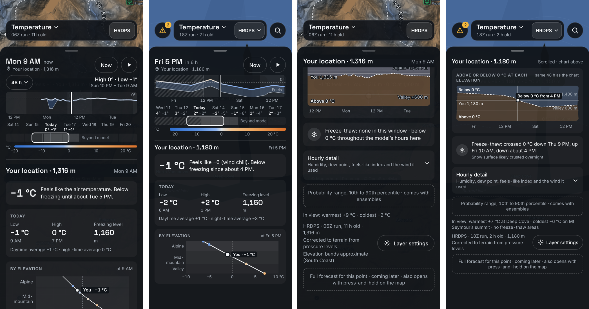
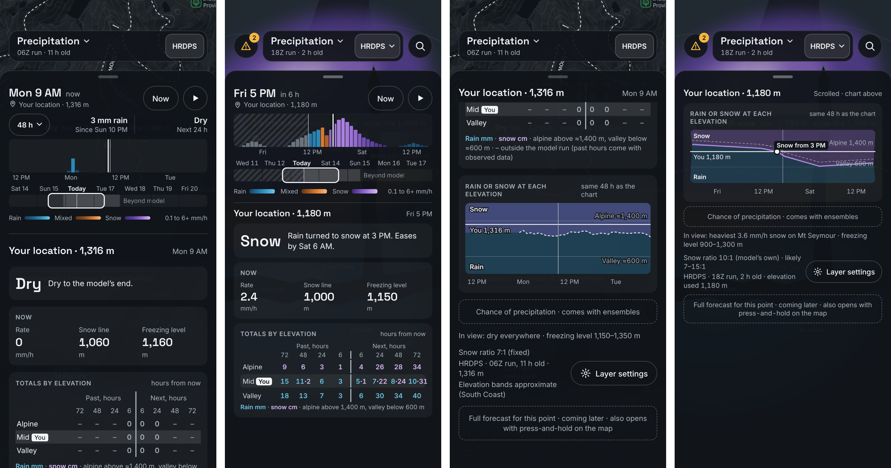
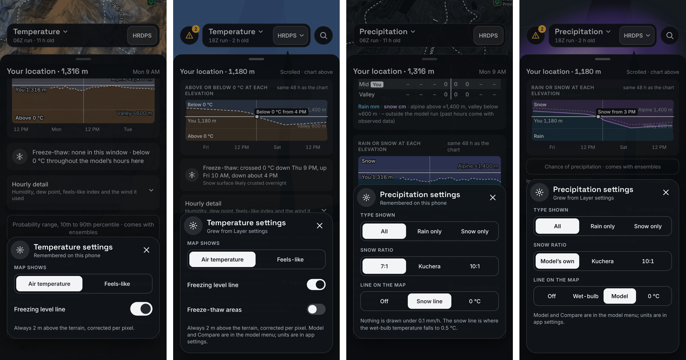

# M5 report: details and settings

Nov 16, 2026.

## First, your three points from M4

1. **The pin's readout now centres above the pin.** Near an edge it still shifts just enough to stay on screen.
2. **The save panel's boxes** show a tick only when that layer is chosen.
3. **Colour while panning.**
   - Temperature now fills a margin past each screen edge, so a normal pan shows colour straight away.
   - On a long pan the map refreshes about twice a second while your finger is still moving, not only when you let go.
   - Precipitation already loads whole-degree squares around the view, so it behaves the same way.

## What you can try on the phone

Close Tempest fully and reopen it. Pull the sheet up on either layer.

**Temperature** (designs 20, 21, 22):

- **Headline:** the temperature and a sentence: "Feels like −6 (wind chill). Below freezing since about 4 PM."
- **TODAY:** low and high with their hours, the freezing level, and day and night averages (split at sunrise and sunset at the pin).
- **BY ELEVATION:** the model's profile at the cursor hour, with your "You" dot on it and 0 °C marked.
- **ABOVE OR BELOW 0 °C AT EACH ELEVATION:** the freezing level across the chart's window, your height, and when your height switches.
- **Freeze-thaw:** when the pin crossed 0 °C in the window. "Snow surface likely crusted overnight" appears after a thaw of 3 hours or more followed by a refreeze at night.
- **Hourly detail** (tap to open): air, feels-like and which index, humidity, dew point, and the wind used.
- **Coming later** (probability), **In view** (warmest and coldest on screen), and the **footer**: model, run and age, your height, method, and **Layer settings**.

**Precipitation** (designs 15, 16, 17):

- **Headline:** the type now and what changes next: "Rain turned to snow at 3 PM. Eases by Sat 6 AM."
- **NOW:** rate, snow line and freezing level.
- **TOTALS BY ELEVATION:** past and next 6, 24, 48 and 72 hours for Alpine, Mid and Valley. Your band carries "You". Rain is in blue (mm), snow in purple (cm).
- **RAIN OR SNOW AT EACH ELEVATION:** the snow line across the window, with when your height switches.
- **Coming later**, **In view** (heaviest rate on screen and the freezing-level range), and the footer with the snow ratio.

**Layer settings** (the button in the footer), remembered on the phone:

- **Temperature:**
  - Map shows: Air temperature or Feels-like. Feels-like colours the map by wind chill or humidex, by the same rules as the readout.
  - Freezing level line: on or off.
- **Precipitation:**
  - Type shown: All, Rain only or Snow only, on the map.
  - Snow ratio: 7:1, Kuchera or 10:1. This changes the snow totals everywhere.
  - Line on the map: Off, Snow line or 0 °C, drawn dashed and labelled with its height.

## Differences from the designs, on purpose

- **Precipitation's "Model" snow line and "Model's own" snow ratio are left out.** HRDPS's files carry neither. Open-Meteo turns snow water into depth at a fixed 7:1, so that option is labelled "7:1".
  - The snow line the app draws is worked out from the model's temperature and humidity on each level: where the wet-bulb temperature falls to 0.5 °C. That is the rule the architecture notes recommend.
  - "Wet-bulb" is labelled "Snow line", which says what it is.
- **Temperature's "Freeze-thaw areas" switch is not shown.** It has no map design yet, and a switch appears only once it works.
- **"Model and Compare are in the model menu; units are in app settings"** is left out of the settings notes. Those menus don't exist yet.
- **TOTALS BY ELEVATION shows "–" for past hours before the model run.** The design's past 24 to 72 hours need observed data, which comes in M6. Future columns past the model's 48 hours also show "–".
- **The design's alert badge, search and model menu** are not built yet (later milestones).

## Elevation bands: a proposal for you

- **The rule:** alpine starts at the area's typical treeline; the valley band ends 800 m below it.
- **Treelines used:**

| Area | Treeline (alpine above) | Valley below |
| --- | --- | --- |
| South Coast (North Shore, Howe Sound, Fraser Valley) | 1,400 m | 600 m |
| Sea to Sky (Squamish north, Whistler, Pemberton) | 1,650 m | 850 m |
| Coast inland (Duffey, Coquihalla, Manning) | 1,800 m | 1,000 m |
| Columbia Mountains (Selkirks, Monashees, Purcells) | 1,950 m | 1,150 m |
| Rockies | 2,200 m | 1,400 m |
| Northern BC | 1,300 m | 500 m |

- On the North Shore this gives exactly the design's figures.
- The app labels the bands approximate (≈) until you agree. Tell me if a number feels wrong for terrain you know.

## Every number traces to stored data

- **Both layers' cards come from the pin's series:**
  - the model cell at the pin, at real model hours, read at the pin's ground height;
  - amounts from the same map files the map draws;
  - profiles from the point service or its fallback.
- **The unit test** builds a known series and checks each temperature number against it: the headline value, TODAY's low and high and their hours, the freezing level, and the "You" point.
- **The footer names the data behind the screen:** model, run, age and the height used.

## Decisions I made

- **Totals by elevation:**
  - The amount is the pin's model cell.
  - Rain or snow at each band is decided by that hour's wet-bulb temperature at the band's height.
  - Your own band uses your height; the others use the middle of their band.
- **Rain only / Snow only also hide mixed**, since mixed is both.
- **Kuchera** uses the warmest temperature in the column above the ground, up to 600 hPa. Kuchera's own method goes to 500 hPa, which rarely holds the warmest layer.
- **Crossing times** ("Below freezing since about 4 PM") are rounded to the hour, since the model gives hourly steps.
- **Requests stay small.** The map's points ask for humidity only when the snow line is on the map, and for the surface wind only when the Feels-like map is chosen.

## Checks

- **Unit tests: 97 pass.** New: elevation bands, wet-bulb and snow line, Kuchera, totals by elevation, crossing times, time wording, and the temperature traceability test.
- **Browser tests: 22 pass at 390 × 844.** New: both layers' detail cards in order, and settings remembered after a reload.
  - The pulled-up pixel test now masks the live cards.
  - The shell baselines were refreshed, since the placeholder cards are gone.

## What I need from you

1. **Pull the sheet up on both layers on the phone.** Do the cards read well? Is anything missing that you'd use on a mountain day?
2. **The elevation bands:** agree, or give me the numbers you'd use.
3. **Snow ratio default:** 7:1 matches what you've seen so far. Kuchera usually gives deeper, drier snow in cold storms. Which should be the default?
4. **Say go for M6** (models).

## Follow-up after your phone test (Nov 16)

1. **The snow line and the orange band now agree.**
   - They came from two different methods. The colours used the model's own rain/snow split, averaged over 2.5 km squares. The line used the wet-bulb temperature at the real ground height.
   - Now the map colours every spot by the wet-bulb rule at its real height, and the line runs down the middle of the orange band at any zoom.
   - The pin's readout, chart, totals and table use the same rule, so they match the map.
2. **Totals read only rain and snow.** A mixed hour is split by how much of it was snow, so "4 cm snow / 2 mm mixed" now reads as snow plus a little rain.
3. **The headline and the NOW card always describe the present,** whatever time the slider shows. The rest follows the slider.
4. **The totals table fills in.** A span the model only partly covers shows what it holds, faded, instead of "–". The note under the table says so. Earlier hours come with observed data (M6), later ones with more models (M6).

**From your answers:**

- **Humidity in temperature:** the TODAY card now shows the day's humidity range with the dew point under it. The hourly detail already had humidity by hour.
- **Snow ratio:** I chose **Kuchera** as the default, since you asked for the most reliable. A 2026 comparison of 10 methods over 14 storms found Kuchera among the most accurate, and a fixed 10:1 is often off ([Filipiak et al. 2026](https://brian-filipiak-scholar.media.uconn.edu/wp-content/uploads/sites/3631/2026/08/Filipiak_WWE_2026.pdf), [Pivotal Weather](https://home.pivotalweather.com/guides/snowfall)). Those storms were in the US Northeast, so it isn't proven for BC yet. The app's own comparisons over a season can check it.
- **Saving precipitation now keeps the profile too,** because it decides rain or snow at your height and offline must show the same numbers. That adds about 40 values per hour, so a save takes longer. The offline test checks that the numbers match exactly.
