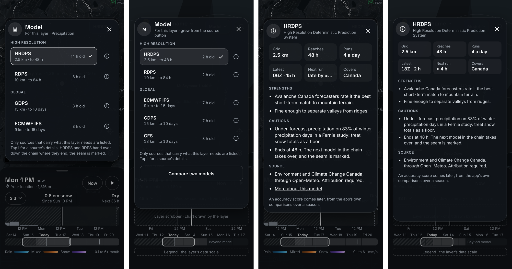
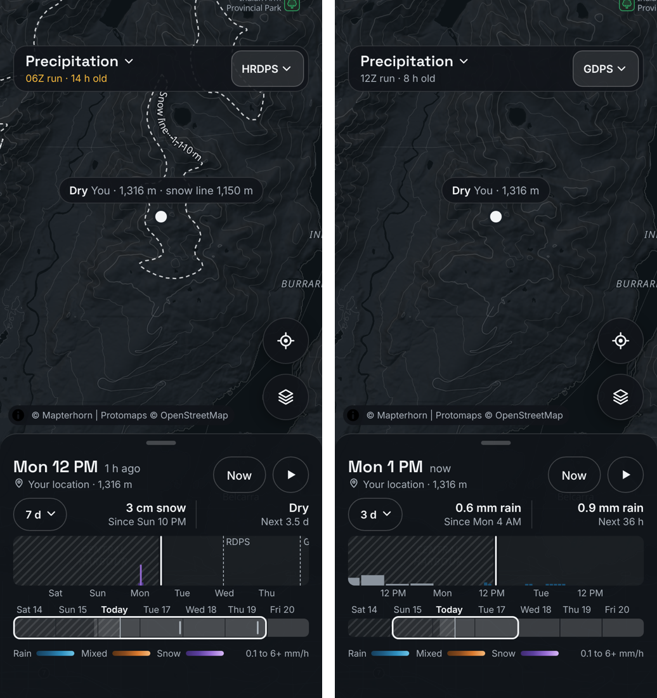

# M6 report: models

Nov 16, 2026.

## First: why the forecast said "13 h old"

This wasn't a fault in the app. **Open-Meteo stopped partway through processing the 12Z HRDPS run.** It started at about 8 AM Pacific and stalled after 13 of its 49 hours. Both of Open-Meteo's sources (the map files and the point service) still served the 06Z run, so 06Z was the newest complete HRDPS. The app showed its age in the warning colour, as it should.

Two things changed:

- **The app now looks for a new run every 10 minutes while it's open.** Before, it only looked when opened.
- **The fallback now helps in exactly this case.** RDPS and GDPS already had their 12Z runs, so the hours after HRDPS's 48 come from fresher runs. The model card shows HRDPS's next run as "late ≈ N h".

## What you can try on the phone

Close Tempest fully and reopen it.

1. **Tap the HRDPS button** (top right). The model menu lists, for this layer:
   - **High resolution:** HRDPS (2.5 km, to 48 h) and RDPS (10 km, to 84 h).
   - **Global:** ECMWF IFS (9 km, to 15 days) and GDPS (15 km, to 10 days).

   Each row shows how old its newest run is. Temperature lists only HRDPS, RDPS and GDPS (see below).
2. **Tap the i** on a row for the model's card:
   - grid, reach, runs a day, latest run, when the next is due (or how late it is), and coverage;
   - strengths, cautions and the source.
3. **The forecast now runs past 48 hours.** With HRDPS chosen, HRDPS covers the first 48 hours, then RDPS takes over to 84 hours, then GDPS to 10 days.
   - The handovers are dashed lines on the chart, labelled with the next model, and marks on the week strip.
   - The model button and the run age at the top always show the model under the cursor.
4. **Choose another model.** The map, the chart, the readout and the totals all change together, and your choice is remembered per layer.
   - RDPS hands over to GDPS.
   - GDPS stops at its own end (10 days).
   - ECMWF IFS stands alone and stops at its end.
5. **The past is hatched** on the chart and the week strip.
   - **Precipitation's past shows what was observed:** grey bars from ECCC's precipitation analysis (HRDPA), which blends rain gauges, radar and HRDPS, in 6-hour totals.
   - **Temperature's past** comes from the model's earlier runs, since no matching temperature analysis is available.
6. **If a model can't be reached,** the next one stands in, and the top bar says so, for example "12Z run · 8 h old · HRDPS unavailable", in the warning colour.

## The acceptance test

"Switching model changes the map, chart and readout together, the cursor stops at each model's end, and an unavailable model falls back visibly."

A new browser test checks each part:

- **Fitting models only:** the menu lists the right models for each layer, and temperature leaves out ECMWF.
- **The info card** opens, and closes with Escape.
- **Switching** to GDPS changes the model button, the run age, the readout and the chart together. The choice is remembered, and the time line then reaches 4 to 9 days ahead, past where RDPS would end.
- **Fallback:** with HRDPS made unreachable, the top bar says "HRDPS unavailable" in the warning colour, and RDPS stands in.

## Decisions I made

- **Choosing a model starts the chain there.** The design's HRDPS card says "Ends at 48 h. The next model in the chain takes over," so:
  - HRDPS continues into RDPS, then GDPS;
  - RDPS continues into GDPS;
  - GDPS and ECMWF IFS stop at their own ends (the cursor goes no further).
- **ECMWF IFS is offered for precipitation only.** Its open data (both the map files and the point service) has no height profile, which temperature needs. Its rain or snow comes from its own split, not the wet-bulb rule.
- **GFS is not offered yet.** The design lists it, but its map files keep precipitation and the height profile in two separate sets. It's a small addition once you want it.
- **"Compare two models" is left out** until the compare view is designed.
- **Where each hour comes from:**
  - The pin's series asks the point service for each model, and stitches the hours together at the seams.
  - HRDPS precipitation amounts still come from the map files, so offline numbers still equal online ones.
  - When the service refuses, precipitation for the longer models comes from their map files.
- **Observed precipitation:**
  - Each 6-hour total is spread evenly over its hours. It replaces the model's amounts in the totals and the table's past columns.
  - The final analysis is used where it exists, otherwise the preliminary one. In tests the two differed by about 0.05 mm.
  - It's online only: ECCC asks that GeoMet not be bulk-copied, so saved areas don't keep it. When a total includes observed amounts, its label says so ("Last 24 h · observed"), since offline the same total comes from the forecast.
- **What a saved area keeps:** the saved run's hours only. Online, the week's past also shows the two days before the run (earlier runs, and observed precipitation). Offline those hours are missing, so a "Last 24 h" total can be smaller offline. The offline test compares hours inside the saved run, where the numbers are identical.
- **A panel opened from another panel's button** (model info from the model menu) now closes on its own. Before, Escape closed the wrong one and left the card on screen.

## Facts checked

- **Open-Meteo's map files** (each model's latest.json, Nov 16):
  - HRDPS: 2.5 km, hourly to 48 h, height profile included.
  - RDPS (cmc_gem_rdps_10km): 10 km, hourly to 84 h, height profile included.
  - GDPS (cmc_gem_gdps_15km): to 10 days; its height profile is a separate set every 3 hours (cmc_gem_gdps_15km_upper_level).
  - ECMWF IFS: 9 km, to 15 days, no height profile.
  - HRDPS West (1 km) has no height profile either, so it isn't offered yet.
- **The point service:**
  - One request can return several models at once, with past days included.
  - Asking for more than two weeks counts extra against the free limit, so each request asks only as far as its model reaches.
- **HRDPA on GeoMet:**
  - It answers a single-point question from any website (CORS).
  - It covers the past 30 days, every 6 hours, by end time.
  - The final version currently ends at 12Z; the preliminary one at 18Z.
- **The 12Z HRDPS stall:** Open-Meteo's in-progress file showed 13 of 49 hours, last changed at 16:11 UTC.

## Checks

- **Unit tests: 108 pass.** New: the time line (chain, seams, a model chosen on its own, fallback, models outside the chain) and the HRDPA adapter.
- **Browser tests: 24 pass at 390 × 844.** New: the model menu, info card and switching test, and the fallback test.
  - The shell's pixel baselines were refreshed for the model button's new chevron.

## What I need from you

1. **Try the model menu on the phone.**
   - Do the RDPS and GDPS hours past 48 h look sensible where you know the weather?
   - Is the dashed seam on the chart clear enough?
2. **Observed precipitation:** do the grey bars over the past two days match what you remember?
3. **GFS:** would you like it added to the menu?
4. **Merge pull request #5** (M6), then say go for M7 (wind).
