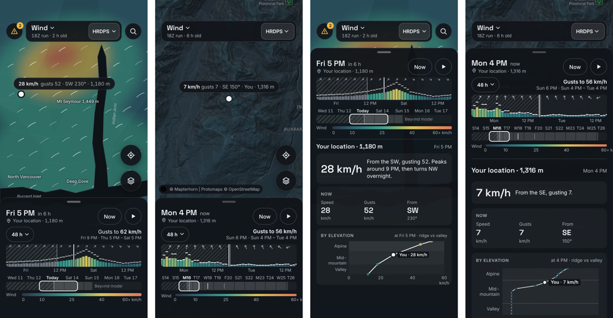
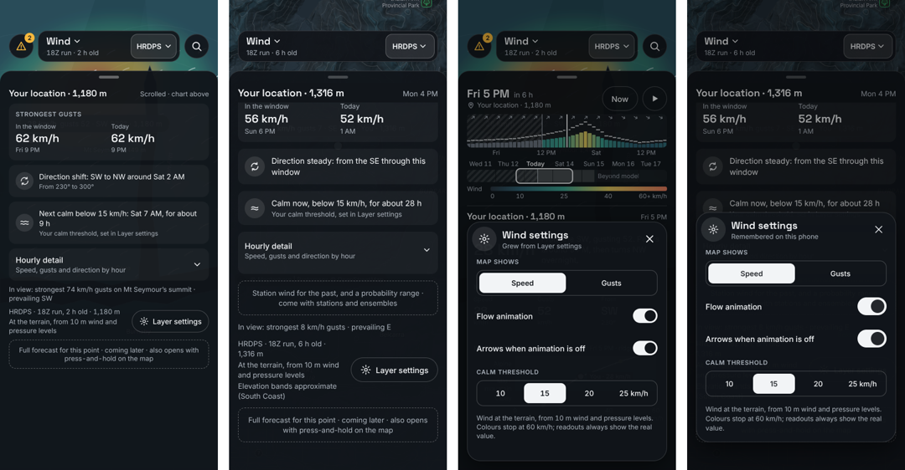
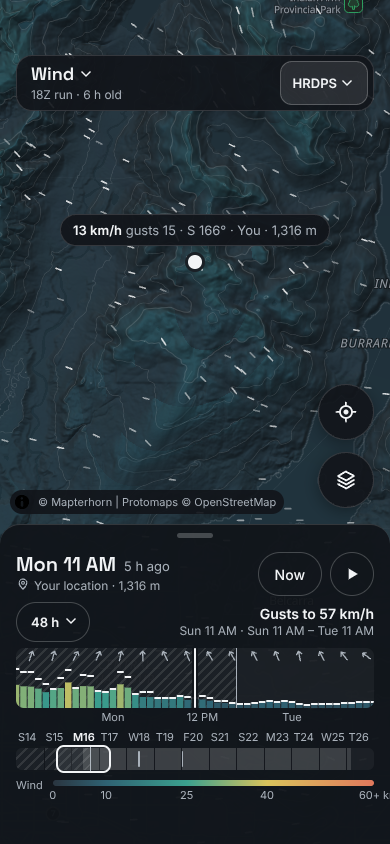
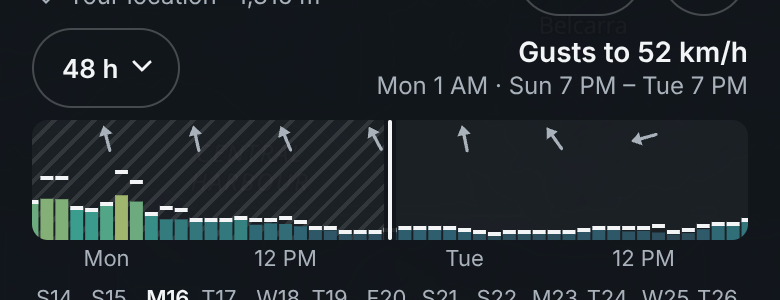

# M7 report: wind

Nov 17, 2026.

## What you can try on the phone

Close Tempest fully and reopen it. Tap the layer name and choose **Wind**.

1. **The map** is coloured by the wind at the ground, from calm (dark) through teal and yellow to orange at 60 km/h and above.
   - Ridges and summits that stand above their surroundings show stronger wind than the valleys beside them.
   - White streaks drift with the wind on top. They hide while you drag the map and come back when you let go.
2. **The pin readout** says, for example, "28 km/h gusts 52 · SW 230° · You · 1,180 m".
3. **The chart** in the scrubber has:
   - a bar for each hour, coloured by speed;
   - a white tick above each bar at that hour's strongest gust;
   - arrows along the top every 3 hours, pointing where the wind blows.

   Above it, the summary gives the window's top gust, when it happens, and the span covered.
4. **Pull the sheet up** for the cards, in the design's order:
   - a headline about the present ("From the SW, gusting 52. Peaks around 9 PM, then turns NW overnight.");
   - NOW: speed, gusts, direction;
   - BY ELEVATION: wind against height, ridge against valley;
   - STRONGEST GUSTS: in the window and today;
   - the next direction shift;
   - the next calm spell, below your threshold;
   - hourly detail;
   - the In view line.
5. **Layer settings** (bottom of the cards):
   - **Map shows:** Speed or Gusts.
   - **Flow animation:** on or off.
   - **Arrows when animation is off:** still arrows on a grid instead.
   - **Calm threshold:** 10, 15, 20 or 25 km/h. It changes the "Next calm" line.

These were taken on a calm day (6–7 km/h at the pin), so the map is mostly dark where the design shows a windy one. Gusts in the window reached 56 km/h on Sunday evening.

## The frame rate: please measure it on your phone

The milestone asks for the measured frame rate on your phone. I can't reach your phone, so:

- **Add `?fps` to the address** (for example `…/tempest/?fps`). A small readout in the top-left corner then shows the frames a second and the time each frame takes to draw. It updates every second.
- **Please send me** the numbers after about 30 seconds on the wind layer, and tell me whether the phone got warm after a few minutes.

**What I measured here**, in a test browser sized like an iPhone (390 × 844 at 3× pixels):

| Processor speed | Frames a second | Drawing time a frame |
| --- | --- | --- |
| Full speed | 56 | 0.15 ms |
| Slowed 4× (about a mid-range phone) | 44 | 1.5 ms |
| Slowed 6× | 56 | 1.1 ms |

- The drawing takes 1 to 1.5 ms of the 16.7 ms a frame has at 60 a second, so the animation itself is light.
- The lower numbers come from the test browser drawing the map without a graphics chip; your phone has one.
- To keep the heat down:
  - the flow is capped at 60 frames a second, even on 120 Hz screens;
  - it uses about 220 short streaks, and no trails that would need the whole screen redrawn;
  - it stops completely when the app is hidden, when the map is moving, and when another layer is shown.

## How the wind at the ground is worked out

The model gives wind 10 m above its own ground and wind at fixed pressure levels higher up. **The model's ground is smoother than the real one**: at HRDPS's 2.5 km grid, a summit sits lower and a valley floor higher than they really are.

So, for each spot on the map and for the pin:

1. **Estimate the model's ground** there by averaging the real terrain over one model cell. The files don't carry the model's terrain, so this stands in for it.
2. **Where the real ground stands above the model's ground** (ridges, summits), read the wind at that height from the levels above, blending up from the 10 m wind.
3. **Where it sits below** (valleys, gullies), keep the model's 10 m wind.
4. **Gusts:** the model's 10 m gust compared with its 10 m wind gives a gust factor. That factor is applied to the wind at the ground, capped at 1.5.

The picture below shows the effect at a breezier hour: ridges pick up colour, valleys stay dark.

The footer says so on every point: "At the terrain, from 10 m wind and pressure levels".

## Decisions I made

- **The gust cap.** At first gusts at the summit used the valley's gust factor unchanged. On Sunday evening at Mt Seymour that turned a 40 km/h summit wind into 86 km/h gusts, because the model's 10 m gust was 2.5 times its light 10 m wind.
  - Exposed ridges typically gust 1.3 to 1.6 times the wind, so the factor is now capped at 1.5. That gives 56 km/h for the same hour.
  - At the model's own ground the model's own gust always comes back unchanged.
- **Direction shift** means a change to another compass point, at least 60° away, that lasts 3 hours. Winds under 5 km/h are ignored, since light wind wanders.
- **Directions** use eight compass points with degrees ("SW 230°"), as in the design.
- **Models offered for wind:** HRDPS, RDPS and GDPS, which carry winds on pressure levels. ECMWF IFS's open data has none, so it isn't offered, as with temperature.
- **The past on the chart** comes from earlier model runs, hatched. Station wind for the past comes with the stations layer; a "coming later" card says so.
- **Saved areas** keep the wind levels, the 10 m wind and gust, and the height profile, so wind works offline with the same numbers.
- **The frame-rate readout** (`?fps`) is a testing aid with no design. It shows only when asked for.

## Found and fixed along the way

- **The map files store wind in metres per second; the app read them as km/h.** I checked one place and hour against the point service: 1.0 in the file is 3.6 km/h there. This affected the feels-like map whenever it fell back to the files (wind chill used about a third of the real wind). Wind from the files is now converted as it's read.
- **Faster layer switching:** the map's profile points now download only the values they don't already have. Switching from temperature to wind adds the wind; it doesn't fetch the temperature profile again.

## Facts checked

- **Open-Meteo's HRDPS map files** (Nov 17) carry:
  - wind speed and direction on every pressure level used;
  - wind at 10, 40, 80 and 120 m, and gusts at 10 m.
- **RDPS and GDPS** carry the same. GDPS keeps its pressure levels in its separate upper-level set, every 3 hours.
- **None of the three** has surface pressure or model terrain, hence the smoothed-terrain estimate of the model's ground.
- **The point service** answers in km/h. The files are in m/s (see above).

## Checks

- **Unit tests: 118 pass.** New: wind parts and directions; wind at a height over the model's ground; gusts with the cap; smoothing the terrain; next calm; direction shifts.
- **Browser tests: 15 pass at 390 × 844.** The new wind test checks:
  - the readout, summary and legend;
  - that the flow runs, stops when the app is hidden and starts again;
  - the cards;
  - that the calm threshold changes the calm line;
  - that turning the flow off stops it;
  - that the choice of layer is remembered.

## What I need from you

1. **The frame rate on your phone** with `?fps`, and whether it got warm.
2. **On a windy day:** do the ridge winds and gusts look right where you know them? A ridge station comparison is the next check I'd like to make.
3. **The flow:** are the streaks the right density, length and speed? Each is one number to change.
4. **Merge the pull request** for M7. Then, as you asked, I'll go through the layers and performance.

## Follow-up: the flow is now a particle simulation

You asked for particles that flow with the wind rather than short dashes.

- **About 400 particles** are carried by the wind at the ground. Each one trails a tail fading over about half a second, so stronger wind draws longer tails:
  - about 14 px at 13 km/h;
  - about 65 px at 60 km/h.
- **Each particle lives 3 to 6 seconds**, fading in and out, then starts again somewhere else.
- **Kept light:**
  - each particle remembers only its last 10 positions;
  - all of them are drawn in five strokes, one per brightness;
  - there is no full-screen fading layer, which is what usually makes these animations heavy and leaves smudges.
- **The same pauses as before:** hidden while you drag the map, stopped when the app is hidden or another layer is shown, at most 60 frames a second.
- **Measured in the test browser:** 57 frames a second. Please check with `?fps` on your phone.

## Follow-up: fewer, clearer direction arrows on the chart

You found the arrows along the top of the chart too crowded. A 48 h window had 16 of them, about 22 px apart.

- **They're now spaced by the room available:** every 3, 6, 12 or 24 hours, whichever first leaves at least 40 px between them.
  - A 48 h window gets one every 6 hours (8 arrows).
  - A 24 h window gets one every 3 hours.
- **They sit on round hours** in BC time: midnight, 6 AM, noon and 6 PM.
- **They're bigger, with a solid head,** and still point where the wind blows.
- **Calm hours (under 3 km/h) show a small dot** instead, since their direction means little.

