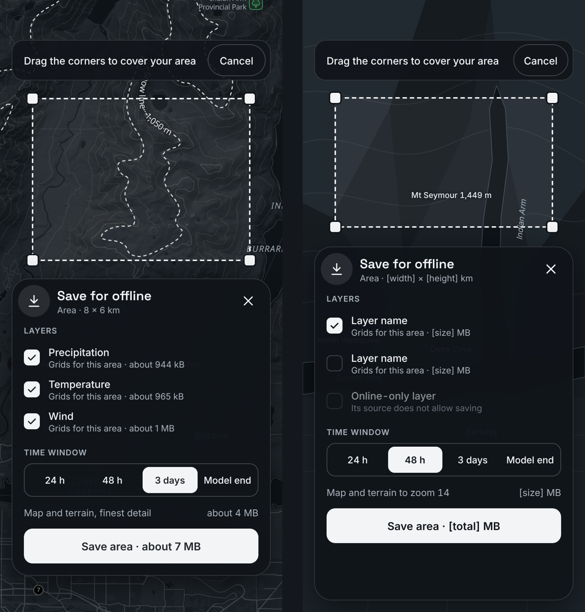
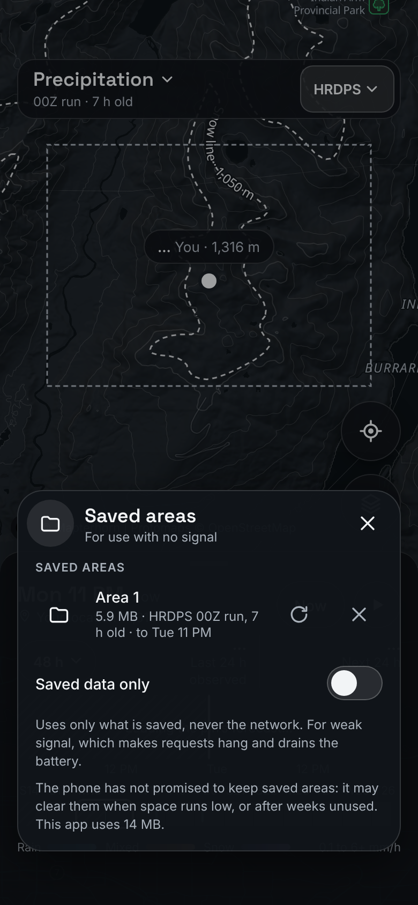
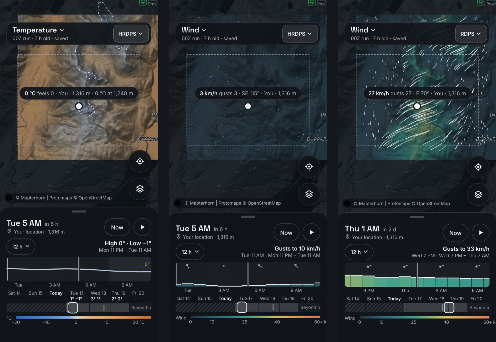

# M8 report: saved areas

Nov 17, 2026.

## What you can try on the phone

Close Tempest fully and reopen it. Do this at home, on Wi-Fi.

1. **Open the map panel** (the layers button, bottom right). Under OFFLINE there are two rows: **Save this area** and **Saved areas** with a count.
2. **Tap Save this area.**
   - A dashed box appears with a handle at each corner. Drag the corners over your touring area; the map still moves under the box.
   - The panel shows the area's size and one row per layer, each with its download size. Tick the layers you want.
   - Choose the time: **24 h**, **48 h**, **3 days** or **Model end**.
   - The line under it gives the size of the map and terrain, and the button gives the total ("Save area · about 7 MB").
3. **Tap Save area.** The button shows progress. A small area takes from under a minute to about four minutes (see "How long a save takes").
4. **Open Saved areas.** Each area shows:
   - its name (the map label nearest its centre, or "Area 1" when there is none);
   - its size, its models and run, and how old the run is;
   - how far it reaches ("to Thu 10 PM"), or **Expired** once every hour has passed;
   - a **refresh** button, which saves the same box, layers and time again from the newest forecast;
   - a **remove** button.

   You can keep several areas.
5. **Saved data only** is the switch in that list. When on, the app reads only what is saved and makes no network requests for weather. Use it on weak signal.
6. **The note under the switch** says whether the phone has agreed to keep saved areas when space runs low. **Please tell me what it says on your iPhone,** once the app is on your home screen.
7. **Go offline** (airplane mode) and reopen the app inside the saved area. All three layers work:
   - **Precipitation** gives the same numbers as online.
   - **Temperature and wind** colour the saved area.
   - **Moving past 48 hours** with 3 days saved changes the model button to **RDPS** and keeps going.

## What changed from M3's rough version

| | M3 | M8 |
| --- | --- | --- |
| Areas kept | One (a new save replaced the old) | As many as you like |
| Time window | 24 h or Model end | 24 h, 48 h, 3 days, Model end, as in the design |
| Past HRDPS's 48 hours | Not saved | RDPS fills the hours after, as online |
| List | Size and age, remove | Name, size, models, run age, reach or Expired, refresh, remove |
| Saved data only | None | A switch |
| Kept by the phone | Asked quietly | Asked, and the list says what the phone answered |

## How long a save takes

The first version of M8 took about **9 minutes** for any area. Most of a save is the temperature and wind values: about 50 values for every hour of forecast. Reading them from the map files means about 80 small downloads per hour of forecast, and the map-file server allows a browser only 6 at a time.

Now the save asks the forecast service instead, for every model grid point in the box at once, with every hour in one request. I checked that this gives the same numbers:
- upper-air values (temperature, height, wind) are identical, cell for cell;
- ground-level temperature differs slightly, because the service corrects it for the real ground height, as it already does for what you see online.

| Save (8 × 6 km, Mt Seymour) | Time on the test machine |
| --- | --- |
| Precipitation, 24 h | 17 to 60 s |
| All three layers, 3 days | 2.3 to 5 minutes |
| All three layers, 3 days, from the map files (before) | about 9 minutes |

Most of the 2 to 5 minutes is waiting: the service's free allowance is about 500 units a minute, and a save uses 600 to 1,200. The app spreads its requests to stay under that, so it never gets refused.

Larger areas, up to about 35 km across, use the same route and take longer. Above that, the save reads the map files, which takes about 9 minutes for any size.

**Sizes.** An 8 × 6 km box with all three layers for 3 days was 7.3 MB:

| Part | Size |
| --- | --- |
| Weather | 1.9 MB |
| Map | 1.6 MB |
| Terrain | 3.0 MB |
| Labels | 0.9 MB |

The estimate on the button said about 7 MB.

## Your question: real measurements for the past

You asked whether the past could be real measurements rather than predictions, without anything drastic. Here is what I found.

| | Real data? | Can the app read it? |
| --- | --- | --- |
| Precipitation | Yes. Environment Canada's measured analysis of radar and rain gauges, on a 2.5 km grid | Already in use since M6: the grey "observed" bars |
| Temperature and wind, Environment Canada stations | Yes, every minute | Yes, directly. But near you they are low: Callaghan Valley 887 m, Whistler village 662 m, Squamish, Pemberton |
| Temperature, wind and snow, mountain stations (highways' avalanche stations such as Blowdown Peak 2,320 m and Cypress about 1,400 m; BC snow pillows) | Yes, hourly | **Not from a web app.** Environment Canada lists where they are, but their readings sit on a server that doesn't let web pages read them. Reading them would need a small server of our own (against the "no backend" rule). Their notices also say "All rights reserved", so the terms need checking first |
| A measured temperature or wind map, like the precipitation one | Not found as open data | No |

**What I'd suggest, with nothing drastic:**
- **A "Measured nearby" line or card** for the pin, from the nearest Environment Canada station: its name, height, distance, and its readings over the past two days, shown separately from the forecast and never blended into it. Useful in valleys; less so on ridges, since those stations are low.
- **Keep the model's past for the map and chart.** It is the best estimate we have at your height.

If mountain stations matter most to you, the honest path is to ask BC's Ministry of Transportation about using their data, and to accept a tiny relay server. That is a decision for you. I haven't built any of this; tell me if you want the "Measured nearby" card.

## Choices I made (listed in docs/06)

- **"Model end"** means the end of RDPS, about 3½ days: HRDPS, then RDPS. GDPS (10 days, 15 km) is not saved.
- **The 48 h default** follows the design screen.
- **Area names** come from the nearest map label. On the test box no label was close enough, so it says "Area 1". There is no way to rename yet (no design).
- **Expired** means every saved hour has passed. An older run that still has future hours is not marked expired; the row shows its age instead.
- **The saved areas list and the switch** have no v8 screen. They are built from the existing rows, switch and notes.
- **Offline, temperature and wind fill the saved area in view, not the whole screen.** The colour reaches slightly past the dashed box, to the edge of the model cells saved.

## Checks

- Unit tests: 126 pass, 3 of them new (saved areas with two models, expiry, size).
- Browser tests: the offline test now saves all three layers for 3 days, then checks with no signal:
  - precipitation numbers equal online;
  - temperature and wind fill and read out;
  - the RDPS hours past HRDPS work.

  It passes, and so does a test for the "saved data only" switch.
- The full run had 3 failures:
  - **The map panel picture** changed on purpose (the new Saved areas row). Its baseline is updated.
  - **Two other tests** failed because the forecast service's daily free limit ran out for this test machine during today's testing. It came back "Daily API request limit exceeded"; the test pages got no forecast data. They passed before this milestone and nothing they check was changed. I'll rerun them after the limit resets (4 PM BC time).

## Not done

- **A save that is interrupted** (app closed, connection lost) does not continue later; it has to be started again. The architecture asks for resuming; it needs the save to keep track of its parts, which I'd rather do when we see how often it happens.
- **Real storage numbers on the iPhone:** only you can read them (step 6 above).
