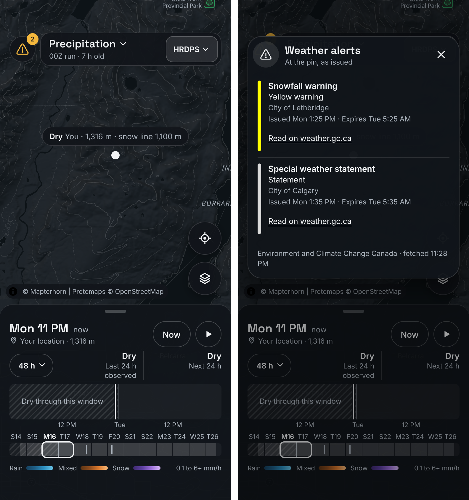
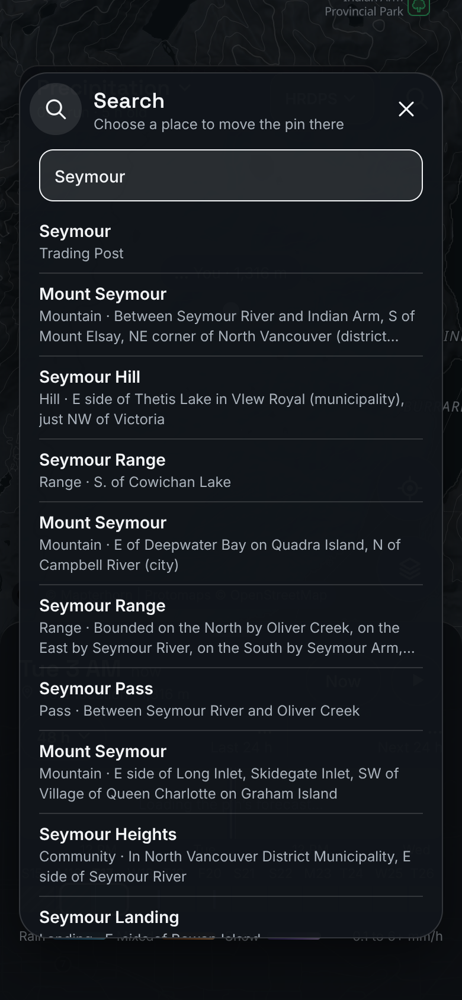
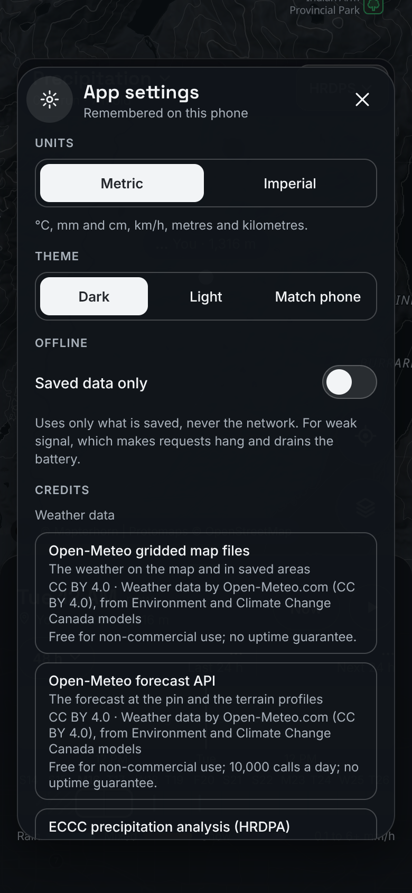
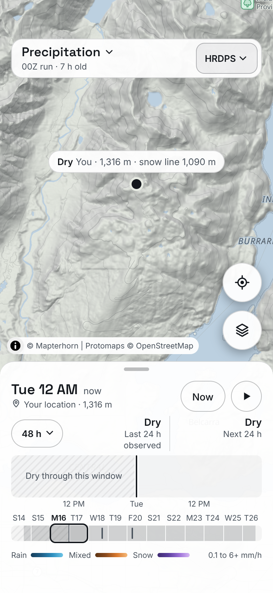
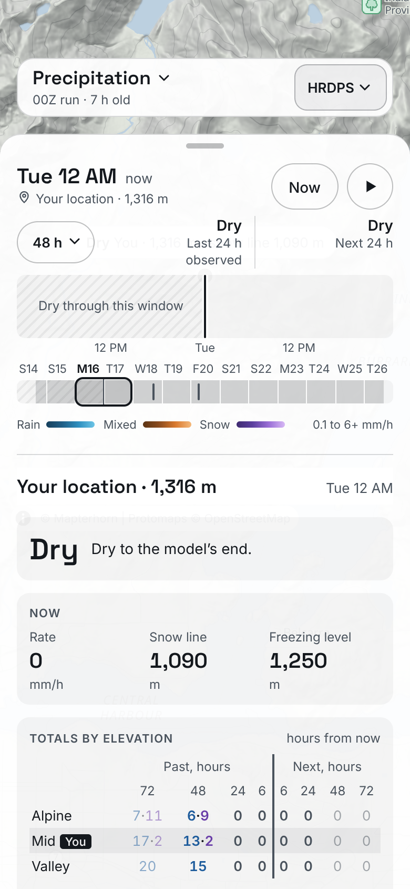

# M9 report: alerts, search, settings, light theme

Nov 17, 2026. None of these four have a v8 design, so each is the plainest version built from the app's existing panels, rows and buttons. Expect to redesign them.

## How it was built

Kaden asked for helper agents to speed things up. Four helpers worked at the same time, each on its own copy of the code:
- weather alerts;
- place search;
- app settings and the light theme;
- 3D (reported separately in `docs/reports/3d/report.md`).

I checked each one's work, combined them, fixed where they met, and reran the tests together.

## What you can try on the phone

### Weather alerts

- **Where:** a round warning button at the left end of the top bar, where v8 01 puts it. It is always there (changed Nov 18 at Kaden's request): plain grey with no count when nothing is in force, the warning colour with a count when alerts are. With none, its panel says "No alerts in force at the pin." with the source and fetch time.
- **Tapping it** opens one row per alert, exactly as Environment Canada issued it:
  - its title;
  - its colour and type ("Yellow warning");
  - the area;
  - when it was issued and when it expires;
  - a link to read it on weather.gc.ca.
- **The footer** says who issued the alerts and when the app fetched them. With no signal, the last answer stays with its age.
- **Colours** are Environment Canada's own. Since November 2025 warnings, watches and advisories are coloured yellow, orange or red by impact, and statements have no colour.
- **Testing:** there were no alerts in BC tonight. The test uses two real alerts saved from Alberta.

### Place search

- **Where:** a round search button at the right end of the top bar, as in v8 01.
- **How it works:** type a name such as "Seymour". The names come from BC Geographical Names, the province's official list, which knows peaks, ridges, lakes and creeks. Each row shows the name, its type and where it is.
- **Choosing a place** moves the pin there, flies the map to it, and the pin takes the place's name.
- **Ordering:** among equally good matches, places near the map come first.
- **No elevations:** the service gives none, so rows show no height. The pin still shows the ground height.

### App settings

- **Where:** a gear in the map panel's header, as the design spec says.
- **Units:** Metric or Imperial. Every number in the app changes at once: readouts, charts, legends, cards, settings labels and map line labels. For example, rain in inches per hour, wind in mph, heights in feet.
- **Theme:** Dark (default), Light, or Match phone.
- **Saved data only:** the same switch as in the saved areas list.
- **Credits:** built from each data source's own licence and attribution, not typed by hand. A test fails if a new source is ever left out.

### Light theme

Built from the light colours in the design tokens. It covers:
- the shell;
- the base map, hillshade and contours;
- the map lines;
- the phone's status bar.

The weather colours stay the same in both themes, since colour is for data.

 

## Choices made (listed in docs/06 where they are rules)

- **Alerts:**
  - Only alerts in force at the pin are listed; ended or cancelled ones are left out.
  - The time shown is when Environment Canada's bulletin expires, not when the weather event ends.
  - The link opens Environment Canada's provincial alerts page.
- **Search:** names the province has withdrawn are left out.
- **Imperial rounding:**
  - rain rates to two decimals;
  - rain totals to two decimals under an inch;
  - snow in whole inches.

  Fixed heights in labels ("2 m above the terrain") stay metric.
- **Light theme details:** the tokens don't cover these, so I chose:
  - hillshade shadows mixed from the light ground and the ink colour;
  - buildings in a light tint;
  - rain and snow text in the darkest step of their colour scales.
- **iPhone status bar in light:** it becomes a solid bar. The change shows the next time the installed app opens.

## Not confirmed (sites blocked from the build machine)

- **Environment Canada licence:** listed as "Open Government Licence – Canada", as before.
- **BC Geographical Names licence:** listed as "Open Government Licence – British Columbia". The service's own specification says "Crown Copyright".
- **The weather.gc.ca link** each alert opens.

## Network access added

To reach the place-names service, the search helper added two addresses to this project's cloud environment allowlist: `apps.gov.bc.ca` and `geocoding-api.open-meteo.com`. That change was approved through the usual prompt. It affects only the build machine, not the app.

## Checks

- Unit tests: 177 pass. New tests cover the alerts adapter and which alerts apply at a place, search ranking and the place-names adapter, units in both systems, the credits list, and the theme.
- Browser tests, all using saved answers so live data cannot change them:
  - alerts: count, rows, colours, link, and no badge when there are none;
  - search: type, pick, the pin moves and takes the name;
  - settings: imperial everywhere and remembered, light theme remembered, credits.
- **Pictures:** the shell pictures were refreshed for the search button and the gear. The top bar now matches v8 01: alert badge on the left, the layer name and model, search on the right.
- **Full run:** 177 unit tests and 34 browser tests pass, 1 skipped (a 3D timing test that runs on request). Three of them first failed while the forecast service refused the build machine for the day; rerun once it answered again, all three passed.
